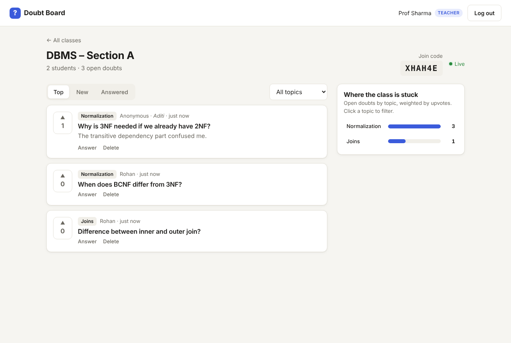
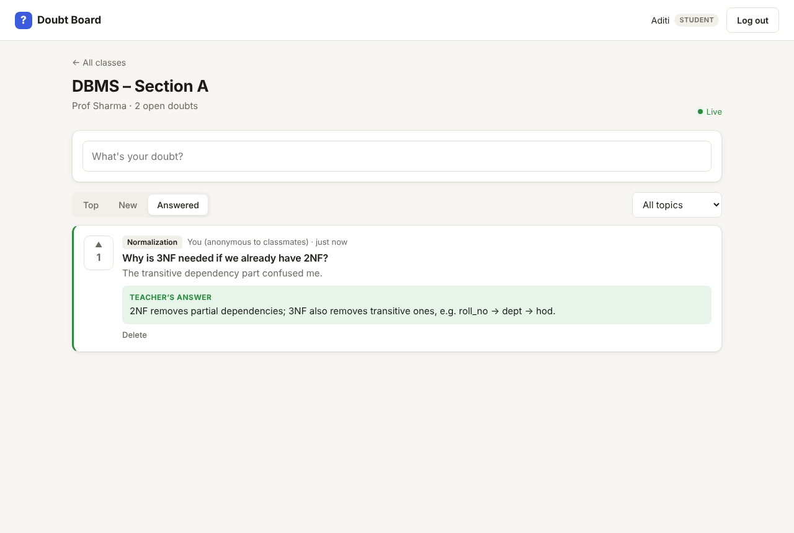

# Doubt Board

A live, anonymous doubt board for classrooms. Students post doubts (anonymously if they want) and upvote the ones they share; the most common doubts rise to the top. Teachers see, in real time, which topics the class is stuck on and answer each doubt once, for everyone.

Built with **MongoDB, Express, React, Node.js** and **Socket.io**.



## The problem

- **Students don't ask.** Many hesitate to raise doubts in front of the class, so confusion stays hidden until exams.
- **Teachers repeat themselves.** The same question comes up in every section, in DMs and in WhatsApp groups.
- **Teachers can't see where the class is lost.** Ten students silently confused about one topic looks the same as nobody being confused.

## What it does

| Students                                                                     | Teachers                                                                                     |
| ---------------------------------------------------------------------------- | -------------------------------------------------------------------------------------------- |
| Join a class with a 6-character code                                         | Create classes and share the join code                                                       |
| Post doubts with a topic, anonymously or by name                             | See every doubt live, including who posted anonymous ones (for moderation)                   |
| Upvote "I have this doubt too" (one vote per student, click again to remove) | See a **"Where the class is stuck"** chart: open doubts per topic, weighted by upvotes |
| See answers appear instantly                                                 | Answer, edit an answer, reopen, or delete doubts                                             |
| Delete their own doubts                                                      | Watch the student count update as students join                                              |

Everything updates live across all open screens — no refresh.



## Architecture

```
 React (Vite) ──HTTP /api──► Express ──► MongoDB (Atlas)
      ▲                         │
      └──── Socket.io ◄─────────┘   live events: doubt:new, doubt:updated,
                                    doubt:deleted, class:students
```

In production, Express also serves the built React app, so the whole project is **one service with one URL** (no CORS setup needed).

### Data model

```
User   { name, email, passwordHash, role: teacher|student }
Class  { name, joinCode (unique), teacher, students[] }
Doubt  { classId, author, isAnonymous, title, body, topic,
         upvotes[userId], status: open|answered, answer { text, answeredAt } }
```

`upvotes` is an array of user ids rather than a counter, so a student can't vote twice. Toggling uses MongoDB's atomic `$addToSet` / `$pull`, so even rapid double-clicks count once.

### How anonymity works (the important part)

Anonymity is enforced **on the server**, not by hiding things in React. If the author's name were sent to the browser and just not displayed, anyone could read it in the browser's Network tab.

- `server/src/utils/serialize.js` builds the JSON each viewer is allowed to see. For an anonymous doubt, students get `author: null` and no author id at all.
- Teachers do see the author, for moderation. The UI tells students this when they post.
- For live updates, teachers and students of a class sit in **separate Socket.io rooms**. Each room is sent its own version of the doubt, so the teacher-only data never reaches students' sockets.
- The REST API and the socket server both check class membership; a socket can't join a class room it doesn't belong to.

### API

```
POST   /api/auth/register            { name, email, password, role }
POST   /api/auth/login               { email, password }
GET    /api/auth/me

GET    /api/classes                  my classes
POST   /api/classes                  (teacher) { name } → generates join code
POST   /api/classes/join             (student) { joinCode }
GET    /api/classes/:classId
GET    /api/classes/:classId/doubts  all doubts, shaped for the viewer
POST   /api/classes/:classId/doubts  (student) { title, body, topic, isAnonymous }

POST   /api/doubts/:id/upvote        (student) toggle
POST   /api/doubts/:id/answer        (teacher) { text }
POST   /api/doubts/:id/reopen        (teacher)
DELETE /api/doubts/:id               (author or teacher)
```

Auth uses JWTs (7-day expiry) sent as `Authorization: Bearer <token>`; passwords are hashed with bcrypt. Sockets authenticate with the same JWT.

## Run locally

You need **Node 18+** and a MongoDB connection string (a free [MongoDB Atlas](https://www.mongodb.com/atlas) cluster, or a local `mongod`).

```bash
# 1. Install everything
npm run install:all

# 2. Configure the server
cp server/.env.example server/.env
#    then edit server/.env: set MONGO_URI and JWT_SECRET

# 3. Start the API (terminal 1)
npm run dev:server        # http://localhost:5000

# 4. Start the React app (terminal 2)
npm run dev:client        # http://localhost:5173
```

Open http://localhost:5173. Vite forwards `/api` and WebSocket traffic to the server.

**To try the live updates:** open one normal window and one or two private/incognito windows (each window keeps its own login). Register a teacher in one and students in the others.

## Project structure

```
doubt-board/
├── server/
│   └── src/
│       ├── index.js            Express app, static client, error handling
│       ├── config.js           env vars
│       ├── socket.js           Socket.io auth, rooms, broadcast helpers
│       ├── models/             User, Class, Doubt
│       ├── routes/             auth, classes, doubts
│       ├── middleware/auth.js  JWT sign/verify, role checks
│       └── utils/              serialize (anonymity), joinCode, asyncHandler
├── client/
│   └── src/
│       ├── pages/              AuthPage, Dashboard, ClassBoard
│       ├── components/         DoubtCard, NewDoubtForm, TopicChart
│       ├── api.js, auth.jsx    fetch wrapper, auth context
│       └── styles.css          light + dark theme, mobile layout
├── render.yaml
└── package.json                root scripts for build/start
```

## Possible extensions

- Mark duplicate doubts and merge their upvotes
- Doubt sessions per lecture (e.g. "Lecture 7") with export to PDF
- AI-suggested grouping of similar doubts
- Rate limiting and profanity filtering for posts
